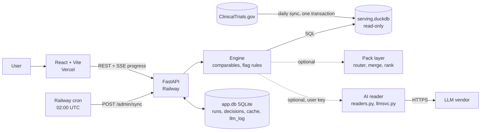

# High-level design: Precedent Check

Status: describes what is built (as of 2026-11-19), plus one clearly marked design that is **not** built (section 7). Sources: `docs/user_flow.md`, `docs/safety.md`, `docs/compliance.md`, and the code in `backend/`.

## 1. What it does, in one paragraph
A design lead submits a draft trial design. The system finds the 30 closest past trials in a local copy of ClinicalTrials.gov, computes where the draft looks unusual (population cutoffs, sites, endpoint, sample size, control arm), and shows at most 3 flags, each with its count and NCT IDs. An optional LLM, using the user's own key, reads eligibility text and rewords finished sentences. Nothing else.

## 2. The central design rule
**SQL decides, AI reads.** Every number and every NCT ID is produced by SQL or code. The model never supplies one. So the architecture is a **deterministic pipeline with an LLM reader**, not an agent: there is no planning loop, no tool selection and no model-driven control flow. Section 7 says when that would change.

## 3. Components

| Component | Where | Job |
|---|---|---|
| Registry store | `serving.duckdb`, opened read-only | Flat tables of about 610k studies. A request cannot change it. |
| Sync | `sync/`, `sync-cron/` | Daily delta, Sunday full ID check. All-or-nothing; 2-day overlap on the watermark. |
| Engine | `backend/engine.py`, `flagrules.py`, `flag_config.py` | Find and rank comparables, count outcomes, apply flag rules. Thresholds live in `flag_config.py`. |
| Packs (optional) | `backend/packlib/`, `src/packs/` | Per-area YAML: router picks by MeSH, merge, ranking hints. Draft status, off unless chosen. |
| AI reader (optional) | `backend/readers.py`, `llmsvc.py`, `byok.py` | Read criteria text into cutoffs; reword finished flags. Budget, cache, log, key handling. |
| App state | `app.db` | Runs, packages, decisions (audit), LLM cache and log, anonymous usage. |
| Front end | `frontend/` | Form, confirm, results, flag decisions, package, compare view. |

## 4. One run, end to end
1. **Brief.** Parse the pasted design, or load a registry trial by NCT ID. The user confirms fields and cutoffs.
2. **Comparables.** SQL pool: same condition (MeSH), interventional, overlapping phase. Score = 0.7 text similarity + 0.2 cutoff overlap + 0.1 intervention type; re-score the top 200 with eligibility text; keep the top 30. A pack, if chosen, adds ranking hints and a drug-vs-device filter.
3. **Outcomes and stop causes.** Counts by bucket, stop-cause labels from the stored classifier.
4. **Element checks.** Sites, endpoint, design, size: SQL rules. Population: reads the comparables' eligibility text (AI if a key is present, rules if not), within a 40 s budget.
5. **Flags.** Rules decide. Fewer than 5 comparables: "insufficient", no flags. At most 3 are kept, strongest first. Each carries `n` and up to 50 NCT IDs.
6. **Reword (optional).** The AI rewords each flag's sentence; code refuses anything not in the evidence.
7. **Decide.** The user accepts, keeps (with a reason) or defers each flag. Every decision is logged with time and role. A package can be sent to a reviewer.

Progress streams to the browser over SSE with a 10 s keep-alive, because a run takes tens of seconds.

## 5. Model choice
| Job | Model today | Why | Alternatives and when to switch |
|---|---|---|---|
| Read criteria into cutoffs | `openai/gpt-oss-120b` on Groq (OpenAI-compatible) | Free tier, JSON output, passes the quality bars on the gold set except speed under rate limits | A paid model with higher rate limits before any default-on use; re-run the eval first (D30) |
| Fallback | `openai/gpt-oss-20b` | Cheaper, used if the first fails | Two further fallbacks in `.env` return 404 on this account (D36): remove or fix |
| Reword flags | Same chain | Low volume, short text | Skip it if cost matters; flags are readable without it |
| No key | Rule reader (`criteria.py`) | Free, instant, deterministic | 24% strict recall vs 63% for the AI reader |

The provider is swappable: one OpenAI-compatible client, settings from `.env`, and a model change requires re-running `eval_reader` against the pass bars.

## 6. Trust boundaries
| Boundary | Rule | Where enforced |
|---|---|---|
| Registry to engine | Read-only | DuckDB opened read-only |
| Model output to the screen | A limit must quote a sentence found in the source; injected text cannot become a limit | `readers.quote_ok`, `looks_injected`, `test_injection.py` |
| Engine to model | Only the criteria text and comparables' eligibility text leave the server, only with the user's key | `byok.py`; `docs/compliance.md` |
| User key | Per request, never stored or logged; private-IP URLs refused | `byok.py`, `test_byok.py` |
| Cost | 60 calls per run, $0.50 per day, 40 s per run, answer cache | `llmsvc.py` |
| Flags | At least 5 comparables, `n` and IDs on every flag | `engine.py`, `eval_grounding.py` |

## 7. Not built: an optional agent layer (design only)
**Why consider it.** Today a "no flag" or "insufficient" run ends with a message. A design lead's next question is "why so few comparables, and what if I loosened the phase or the condition?" An agent could investigate that.

**Shape (one agent, read-only).** After the run, an optional "Investigate" button starts a loop of at most 6 steps. The model may call only these tools, all of which run SQL and return rows:
- `count_comparables(relax)`: how many comparables if one filter is relaxed (phase, condition level, drug-vs-device)
- `list_trials(filter)`: NCT IDs and one-line summaries for a given filter
- `outcome_mix(ids)`: completed, terminated, withdrawn counts for a set

**Rules it keeps.** Same as today: the model supplies no number; it chooses which tool to call, and every figure it states must come from a tool result with its NCT IDs. It cannot change flag rules, thresholds or decisions. The user sees each tool call and its SQL (the app already exposes an audit list). Results are labelled "exploration, not a flag".

**How it would be judged.** (1) Groundedness: every number and ID in the answer appears in a tool result. (2) Task: does it find a loosening that yields at least 5 comparables when one exists? (3) Cost and steps: median under 4 steps and under $0.02. (4) The existing hostile-text set, extended with tool-argument attacks.

Full design, tool contracts, verifier, eval bars and kill criteria: `docs/agent_design.md`.

**Why not now.** The core value is "every flag is grounded", and that is already delivered by a pipeline. An agent adds failure modes (loops, wrong tool use, cost) without a measured user need. Build it after a pilot shows people ask the follow-up question.

## 8. Main tradeoffs
| Decision | Chose | Gave up |
|---|---|---|
| Who produces numbers | SQL only | Fluent model "insights" |
| No retrieval-augmented generation | Structured SQL over typed fields | Free-text answers over trial documents |
| Key | Bring your own, never stored | Visitors need a key for AI features |
| Store | Read-only DuckDB, changes only through the sync | Live edits |
| Packs | Optional, base path untouched, draft status shown | Extra code; small measured effect (`Prompt_EVALS/RESULTS.md`) |
| Deploy | Manual `railway up` and `vercel deploy` | Auto-deploy from GitHub |

What did not work, and every reader-eval choice with who decided and why: `Prompt_EVALS/DECISIONS.md` and `CASE_STUDY.md`.

## 9. Known gaps
- No sign-in and no draft retention limit (`docs/compliance.md`, R05).
- AI reader not the default: it has not cleared the speed bar on the free tier, and its precision is a single run (`Prompt_EVALS/RESULTS_TABLE.md`).
- No real-user data yet, so task and outcome metrics are empty (`docs/metrics.md`).
