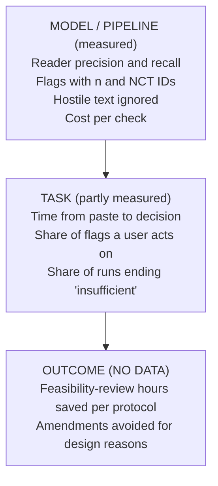

# Metrics: from model quality to a user outcome

**Value claim** (from the discovery work): a design or feasibility lead sees, before a protocol is final, where the draft departs from past trials, so fewer departures are found late as amendments.

**Status key:** MEASURED = a number from this repo with its source. TARGET = a goal, not yet measured. NO DATA = needs real users.

## Model and pipeline (measured)
| Metric | Target | Measured | Source |
|---|---|---|---|
| Reader precision (loose), AI reader | >= 85% | 85.8% (single run; range unmeasured) | `Prompt_EVALS/RESULTS_TABLE.md` v3 |
| Reader recall (strict), AI reader | >= 50% | 63.3% (rule reader 24.2%) | same |
| Flags that show n and NCT IDs | 100% | **234 of 234** flags in 142 runs since 9 Nov (dev machine, includes test runs) | `python -m backend.metrics 2026-11-09` |
| Shown NCT IDs that exist in the registry | 100% | 306 of 306 over 5 designs | `python -m backend.eval_grounding` |
| Hostile text cannot change a limit | 100% | 8 of 8 | `eval_reader --edge` |
| AI cost per check | < $0.05 | about $0.005 typical (estimate) | `docs/production.md` |

Guardrail at this level: if any row above falls below target, the AI reader stays off by default.

## Task (needs real users)
| Metric | Target | Measured | Note |
|---|---|---|---|
| Runs ending "insufficient" (under 5 comparables) | under 25% | 23.2% of 142 runs | Dev and test designs, not a real user mix |
| Time from paste to first decision | under 10 min | **no data** | The local median shows 0.0 min because the test suite decides instantly |
| Flags accepted or kept (vs deferred) | 30 to 70% | **no data** | Local log is 96.5% "defer", which is the test suite deferring every flag |
| Users who say a flag told them something new | at least 3 of 5 in a pilot | **no data** | See `docs/production.md` pilot plan |

Guardrail: a high "defer" share with no accepts means flags are not trusted or not useful. Read it as a warning, not as success.

## Outcome (needs a pilot)
| Metric | Target | Measured |
|---|---|---|
| Feasibility-review hours saved per protocol | to be set with the pilot users | no data |
| Protocol amendments avoided for design reasons | to be set with the pilot users | no data |

No outcome number is claimed. An eval score is not an outcome, and a tool nobody has used for real cannot show one.

## How the task numbers are produced
`python -m backend.metrics [since-date]` reads `runs` and `decisions` in `app.db`. It counts everything in the database, so on a dev machine it includes test runs; filter by date and name the source when quoting it. It does not log "flag opened": the existing tables did not record it, and a pilot should add it only if the interviews need it.

## What this found
- Before 9 Nov the early prototype stored flags without `n` (212 of 536 flags across 6 to 8 Nov). Current runs are 234 of 234. Always filter by date when quoting the grounding figure.
