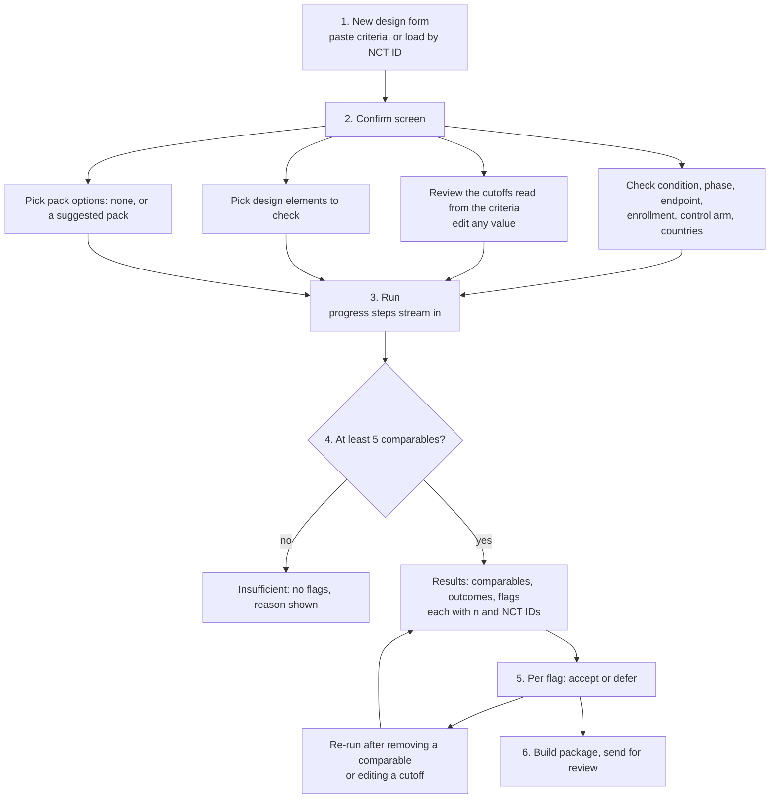

# User flow

**User:** trial design lead or feasibility lead at a sponsor. **Goal:** before a protocol is final, see how close past trials designed the same thing, and where this design looks unusual.

## Steps
| # | Screen | What the user does | What the system does |
|---|---|---|---|
| 1 | New design form | Pastes the draft design and criteria, or loads a registry trial by NCT ID | `/api/briefs/parse` or `/api/briefs/from-nct` turns it into a structured brief |
| 2 | Confirm | Fixes required fields, edits cutoffs, ticks elements to check | Nothing runs until the user confirms |
| 2a | Confirm: how the criteria are read | Default: free rule reader. Optional: adds their own API key under "AI key" for the AI reader | Rule reader finds fewer limits (24% strict recall vs 63%); key is sent per request, never stored |
| 2b | Confirm: pack options | None (default), or the suggested therapeutic-area pack, or another pack of their choice | `/api/packs/route` suggests, never decides; draft status shown |
| 3 | Run | Waits | SQL finds comparables and builds every number; AI (if on) only rewords finished sentences |
| 4 | Results | Reads comparables, outcomes, flags | Under 5 comparables: "insufficient", no flags |
| 5 | Flags | Accepts or defers each flag | Decision logged with role and time |
| 6 | Re-run, package | Removes a comparable or edits a cutoff and re-runs; builds a package for a reviewer | Re-run returns a diff; reviewer decisions are recorded on the package |
| 7 | Compare (packs only) | Views with-pack vs without-pack results side by side | Shows what changed, not which is better |

## Where the user chooses
- **How criteria are read:** rule reader (default) or AI reader (own key). A pack can be added to either.
- **What gets checked:** the design elements, and any comparable they exclude.
- **What counts:** each flag is accepted or deferred by the user; the AI never closes one.
